# PRAXIS

### Business Process Optimization & Automation

**Simulated operations, SQL database, EPC process maps, and human-reviewed workflows.**

PRAXIS is an operations software prototype built around a practical business problem: incoming service requests need clear review, ownership and follow-through. A message being read does not mean the underlying issue has been resolved.

The demonstration follows a fictional commercial-equipment maintenance company in Quebec. It brings service intake, coordinator review, assigned follow-ups and technician visibility into one workspace.

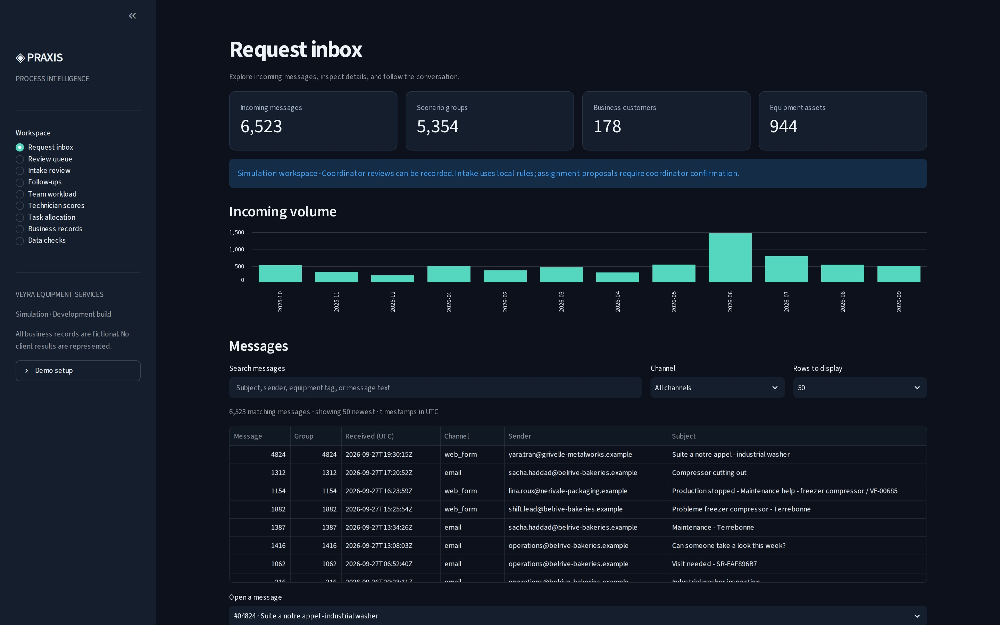

## Application screenshots

Actual PRAXIS screens with linked simulated operating data. No hosted application is required to view these previews.

SS1 — Request inbox

SS2 — Review queue

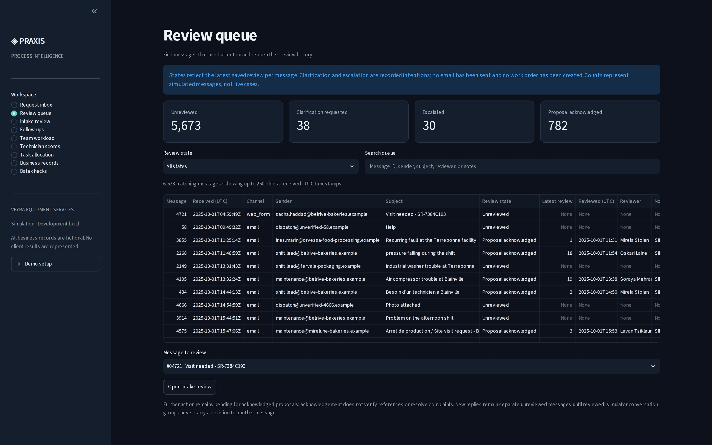

SS3 — Intake review

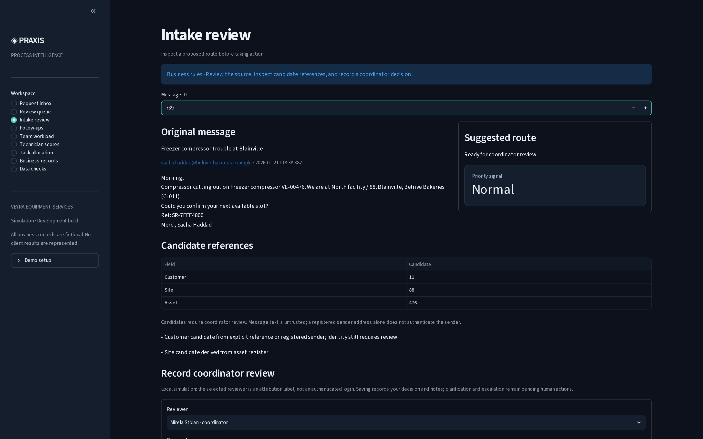

SS4 — Follow-ups

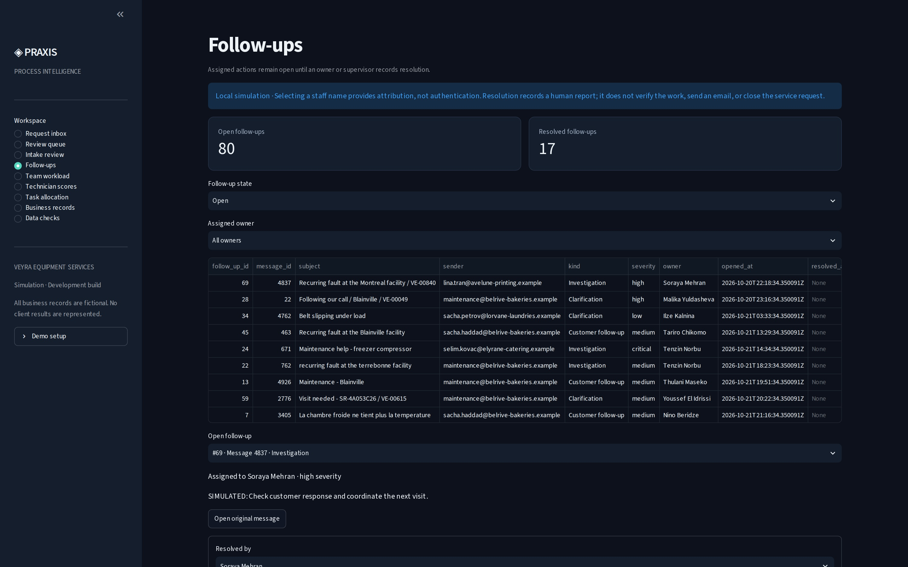

SS5 — Team workload

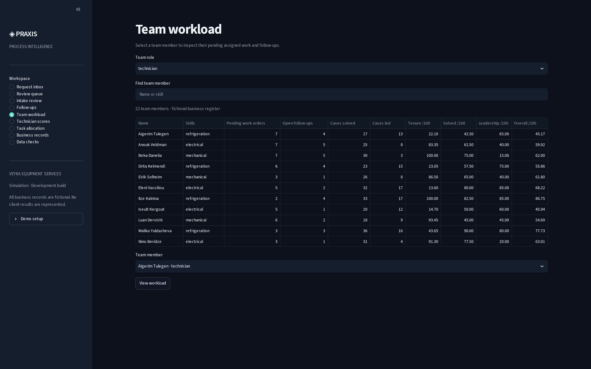

SS6 — Technician scores

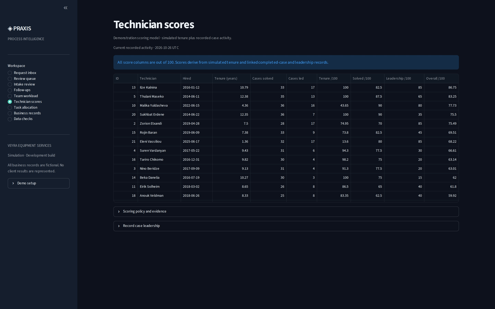

SS7 — Task allocation

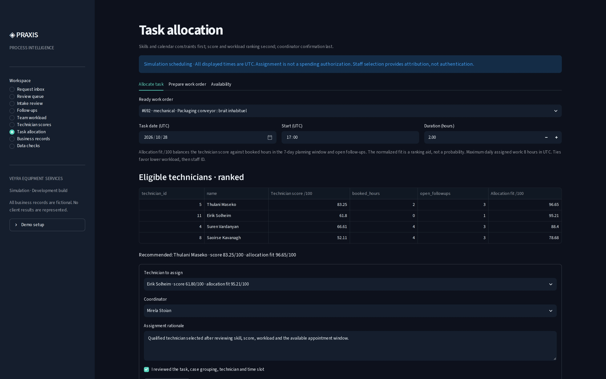

SS8 — Business records

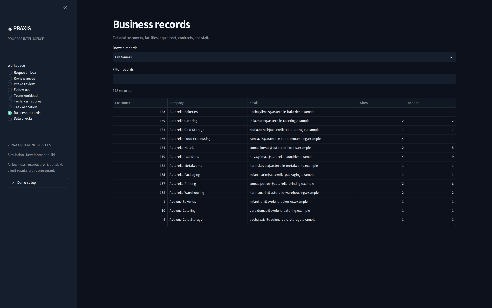

SS9 — Data checks

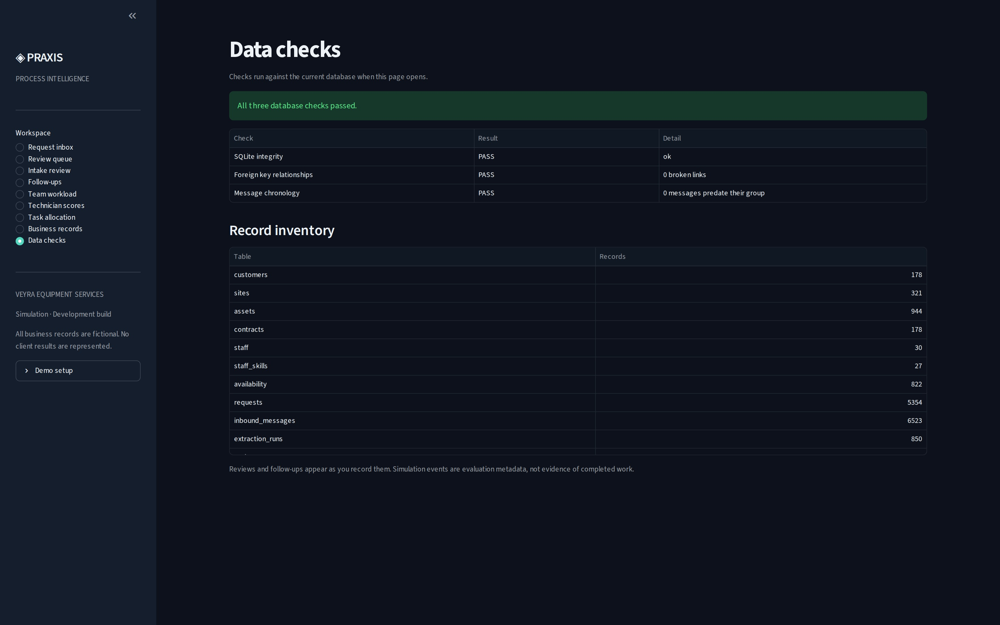

SS10 — Technician workload detail

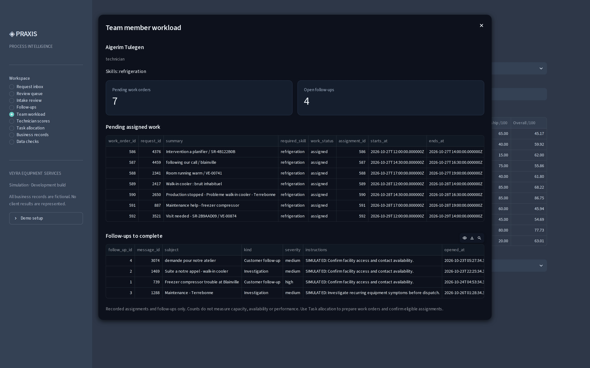

## Process overview

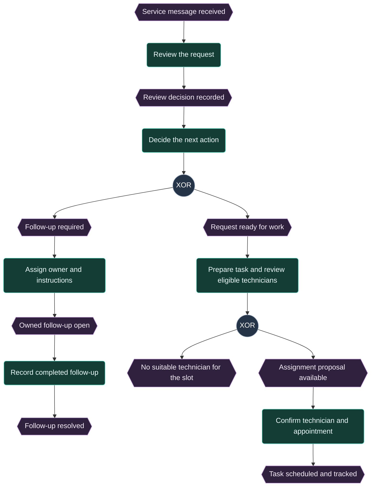

This simplified view shows the demonstrated human review and follow-up flow. A review alone does not resolve a request. Follow-up completion is reported by a person; full service-case closure remains in development. Detailed EPC maps and internal decision rules remain in the private repository.

## What the prototype demonstrates

| Business need | Demonstrated capability |
| --- | --- |
| Find incoming requests | Searchable inbox with original message details |
| Identify messages needing attention | Review queue with clear recorded dispositions |
| Keep human judgment in the process | Saved review decisions, notes and history |
| Make responsibility visible | Assigned follow-ups with open and resolved states |
| Inspect technician work | Team directory and individual workload windows |
| Explain technician scores | Tenure, solved-case, leadership and overall scores, each out of 100 |
| Allocate suitable technicians | Ranked eligible candidates, workload balancing and coordinator-confirmed appointments |
| Support process analysis | Private EPC process documentation and improvement hypotheses |
| Check data consistency | SQL-backed relationship and integrity checks |

## Demonstration environment

- **6,523 simulated incoming messages** with varied wording, sender addresses and demand patterns.
- **178 fictional customers** across **321 facilities**, with **944 equipment assets**.
- **30 fictional staff members**, including **22 technicians**.
- English and French examples, incomplete details, follow-ups and other intake exceptions.
- Populated operating-history demo: 585 simulated completed cases, 106 pending assignments and 43 ready work orders. These are generated scenario records, not measured customer outcomes.

All names, communications and business records are fictional. The dataset is a demonstration corpus rather than a live company backlog. No client results or measured time savings are represented.

## Technology and professional scope

**Python · SQL / SQLite · Streamlit · Business analysis · EPC process mapping · Workflow controls · Automated testing**

The work combines process analysis, data modelling, application development and functional validation. The current private implementation has passed **54 automated tests**, including data integrity, review persistence, follow-up handling, technician workload isolation and score calculations.

## Project status

**Functional local prototype — under active development.**

The implemented screens support intake exploration, human review, follow-up tracking and team visibility. Task allocation now supports eligibility checks and coordinator-confirmed scheduling. Human-driven work-order completion, a complete service-case lifecycle and production controls remain in development. There is no public hosted application or production deployment associated with this repository.

## About this repository

This is a **public portfolio showcase**, not the application source repository. Source code, database files, internal architecture, detailed process maps, business rules, scoring formulas and development history remain private. This repository contains presentation material only.

Copyright © 2026. All rights reserved. No open-source license or implementation rights are granted.

## Who it benefits

Service-company owners, intake coordinators, dispatchers and technicians: visible requests, assigned follow-ups and clearer workload ownership.

These are intended users and benefits, not evidence of adoption or measured customer outcomes.
